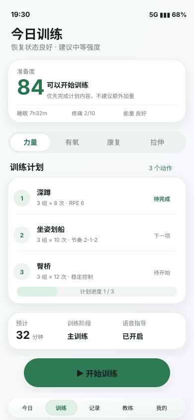
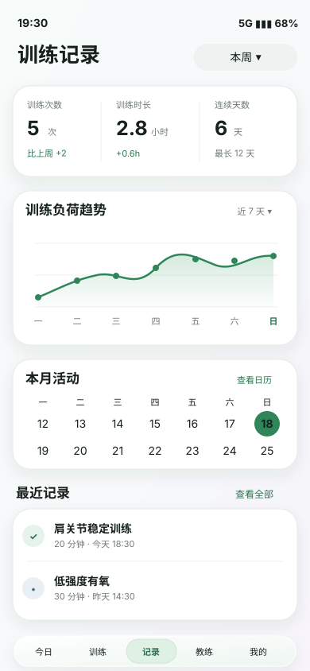
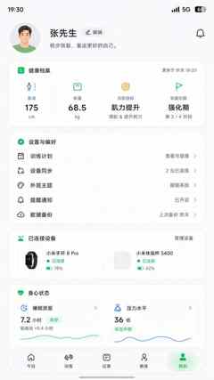

# Rehab V7 低功耗 Liquid Glass 重构任务书

> **执行对象**：Coding Agent / Codex Agent  
> **项目**：`rehab` PWA  
> **目标版本**：V7  
> **核心目标**：保留现有真实业务能力与用户数据，在新分支重建前端架构、页面生命周期、CSS ownership 和低功耗视觉系统；以克制的 Liquid Glass 交互质感替代 V6 中大量常驻模糊、滤镜与玻璃覆盖。  
> **产品视觉定义**：**Calm Health UI with Liquid Interaction** —— 健康训练是主体，Liquid Glass 只是少量关键触控区域的材料语言，不是整页主题。

---

## 0. 最高优先级规则：功能和效果图必须分开理解

本任务存在两个不同的“真相来源”，Agent 不得混淆。

### 0.1 功能真相来源：当前可用 V6

现有项目中的真实功能、数据模型、业务规则、页面入口和已验证交互，是 **功能层唯一真相来源**。

本任务书中的效果图只展示视觉语言。图中的以下内容全部是示例：

- 用户姓名；
- 恢复评分和各类数字；
- 日期；
- 训练项目和动作；
- 卡片数量；
- 设备品牌与名称；
- AI 对话文案；
- 营养/饮水数据；
- 任何示例按钮或标签。

**不得因为效果图中没有出现某个 V6 功能，就删除、弱化或遗失该功能。**

如果某项 V6 功能不适合继续放在主页面，应迁移到：

- 二级页面；
- Sheet；
- Modal；
- Detail Route；
- Settings 子页面；
- 展开区域；
- 其它合理入口。

每项迁移必须记录到 `docs/v7/V7_SCREEN_MAPPING.md`。

> **强制原则：功能适配新的视觉架构，而不是使用效果图替换现有功能。**

### 0.2 视觉真相来源：本任务书附带的 5 张 V7 效果图

效果图只约束：

- 页面气质；
- 信息密度；
- 留白；
- 字体层级；
- 色彩关系；
- 卡片边界；
- 圆角；
- 图标重量；
- Bottom Navigation 几何；
- CTA 层级；
- Liquid Glass 的使用位置和克制度。

**效果图不定义业务范围。**

---

# 1. V7 视觉参考

> 下面的 SVG 是压缩后的内嵌预览，方便在仓库内直接查看。实现时以其整体视觉语言为参考，不要求示例数据逐字一致。

## 1.1 Today / 今日


视觉重点：

- 白色/浅中性色为主；
- 数据和行动优先于装饰；
- 健康绿作为主色；
- 蓝色作为睡眠/信息辅助色；
- 大部分卡片是稳定 Surface，而不是 Glass；
- Liquid Glass 主要用于 Bottom Nav 和关键 CTA；
- 页面路径应保持“今日状态 → 今日计划 → 指标 → 趋势 → 主行动”的清晰节奏。

## 1.2 Workout / 训练



视觉重点：

- 当前训练流程和动作优先；
- Readiness 只做辅助判断；
- 力量/有氧/康复/拉伸用克制分段控件；
- 动作列表保持实体 Surface；
- 主 CTA 可以有短暂 Liquid 质感；
- 不使用装饰性波浪、彩虹折射、大面积发光背景。

## 1.3 Records / 记录



视觉重点：

- 数据工具感强于“玻璃感”；
- 图表、数字、趋势是主要视觉内容；
- 大部分图表容器是普通 Surface；
- Filter 和 Bottom Nav 可以使用轻量 Glass；
- 不允许图表滚动/动画过程中因 Glass 背景导致持续高成本合成。

## 1.4 Coach / AI 康复教练


视觉重点：

- 普通消息气泡尽量实体化；
- 建议/证据卡片可提升一级层级；
- Composer 使用 Soft Glass；
- Suggestion Chips 克制；
- 不能做成霓虹 AI Demo；
- 搜索、证据、模型、附件等原功能必须保留。

## 1.5 Profile / 我的



视觉重点：

- 更像健康档案 + 设置工具，而不是宣传型个人主页；
- 档案、设置、设备、同步和身心状态清晰分组；
- 主体为实体 Surface；
- Liquid Interaction 主要留给导航和少数直接触控控件。

---

# 2. Liquid Glass 技术参考

核心参考项目：

`https://github.com/Kyant0/AndroidLiquidGlass`

Agent 可借鉴：

- Backdrop / Layer Backdrop 思路；
- LiquidButton；
- LiquidToggle；
- LiquidSlider；
- LiquidBottomTabs；
- `pressProgress` 驱动高光、模糊、lens、inner shadow；
- 高成本视觉只在交互期间增强；
- 静止后快速恢复廉价状态；
- 高层组件由本项目自己设计，不直接照搬 Demo。

**禁止把 Android Compose/AGSL 代码机械移植到 Web。**

Web/PWA 只借鉴：

1. 分层；
2. 状态驱动；
3. Interaction Lifecycle；
4. 共享 Backdrop 的思路；
5. Liquid Bottom Tabs 的触感。

第一版不允许把整页 WebGL/WebGPU Shader 作为基础依赖。

---

# 3. V7 重构范围

V7 不是 V6 换皮。

必须重点解决：

1. `index.html` 过度承担 UI、boot 和依赖调度；
2. `PAGE_DEPS` / `SCRIPT_PREREQUISITES` 手工依赖图持续膨胀；
3. 全局 `window.xxx` 通信；
4. Feature 生命周期不清晰；
5. CSS 虽物理拆文件但依旧靠顺序和 override 耦合；
6. Glass 规则散落在 Feature CSS；
7. 大量 `backdrop-filter`、嵌套模糊；
8. `filter` / `box-shadow` 常驻动画；
9. 隐藏页面可能继续持有 timer、observer、RAF、listener；
10. V6 后续覆盖层越来越难拆；
11. 手机 GPU 合成和热量压力；
12. 功耗测试目前不能充分覆盖真实 GPU 渲染。

### 3.1 应重点重构

- App Shell；
- Router；
- Feature Lifecycle；
- UI primitives；
- CSS architecture；
- Effects system；
- Bottom Navigation；
- DOM rendering ownership；
- 页面视觉；
- 性能/功耗约束。

### 3.2 应尽量保留/包装

- IndexedDB / Storage；
- 数据 Schema；
- Workout Engine；
- Plan / Routine Domain；
- AI API / Routing；
- Search；
- Sync / Backup；
- Voice；
- MediaSession；
- WakeLock；
- PIP；
- Report / Metrics Pure Logic；
- 已有经过测试的业务规则。

不要为了“代码更现代”而重写稳定业务算法。

---

# 4. Git 与分支规则

准备本任务书时，项目工作在现有可用分支上。Agent 开工前必须再次执行：

```bash
git status
git rev-parse HEAD
git branch --show-current
```

记录：

- stable/base 分支名称；
- baseline commit；
- working tree 是否 clean。

然后创建新的 V7 工作分支，例如：

```text
v7-liquid-glass
```

如果已有专门 V7 分支，则使用已有分支。

### 禁止

- 在稳定分支上完成整套 V7；
- force push 稳定分支；
- 在未验证兼容性的情况下破坏 V6 IndexedDB 数据；
- 一个巨大 commit 完成整个 V7。

---

# 5. 目标源码 ownership

推荐目标，不要求一天完成移动：

```text
src/
  app/
    bootstrap.js
    router.js
    lifecycle.js
    context.js
    events.js

  ui/
    tokens/
    primitives/
    effects/
    navigation/

  features/
    today/
    workout/
    records/
    coach/
    profile/

  domain/
    workout/
    health/
    nutrition/
    plan/
    records/

  services/
    storage/
    ai/
    search/
    sync/
    voice/

  platform/
    pwa/
    wake-lock/
    media-session/
    haptics/

  legacy/
    adapters/
```

### 技术方向

优先使用：

```text
Vite + Vanilla JavaScript / ES Modules + 现有成熟业务模块
```

本阶段不要同时强制迁移 React/Vue/Svelte 等框架。若后期确认框架迁移有明确收益，单独立项。

---

# 6. CSS 架构

**生产环境最终仍然输出一份 CSS 是允许且合理的。**

V7 要解决的是源码 ownership 和 cascade，而不是为了拆包增加新的 CSS loader。

推荐：

```css
@layer reset;
@layer tokens;
@layer base;
@layer primitives;
@layer effects;
@layer features;
@layer states;
@layer overrides;
```

Feature 必须有明确 scope，例如：

```css
[data-page="today"] {}
[data-page="workout"] {}
[data-page="records"] {}
[data-page="coach"] {}
[data-page="profile"] {}
```

业务 Feature 不允许自行随意声明高成本 `backdrop-filter`，Glass 必须由 `ui/effects/` 集中管理。

---

# 7. Liquid Glass 使用预算

这是硬规则，不是建议。

## 7.1 Surface：约 70–80%

适用：

- 普通内容卡片；
- 动作列表；
- 设置列表；
- Chat Bubble；
- 图表；
- 日历；
- 统计卡；
- 历史记录。

特征：

- 实色/近实色；
- hairline border；
- 极轻 shadow；
- 无 backdrop；
- 无滤镜动画。

## 7.2 Soft Glass：约 15–25%

适用：

- Composer；
- Filter；
- Floating control group；
- Sheet Header；
- 少数 Chip。

优先使用：

- 半透明 Surface；
- 边缘高光；
- inset highlight；
- 静态 gradient；
- 可以完全没有真实 `backdrop-filter`。

## 7.3 Liquid Interaction：约 2–5%

只用于：

- Bottom Nav active indicator；
- Workout 主 CTA；
- Slider / Toggle；
- 特殊 FAB；
- 按压态 / 拖动态。

**不得用于所有卡片。**

---

# 8. Liquid Interaction 生命周期

静止态：

```text
Surface / Soft Glass
无持续 shader
无高频 RAF
无常驻 filter 动画
```

按下：

```text
pointerdown
→ 增强 rim highlight
→ 轻微 scale / deformation
→ touch-position gradient
→ 必要时短暂增强 lens/backdrop
```

拖动：

```text
pointermove
→ highlight 跟随触点
→ 轻微 anisotropic deformation
→ RAF 节流，每 frame 最多一次
```

释放：

```text
pointerup / pointercancel
→ spring back
→ 200–300ms 内恢复静态状态
→ 移除 will-change
→ 停止 RAF
```

---

# 9. 功耗硬规则

V7 必须遵守：

```text
同一 viewport 实时 backdrop 原则上 <= 2
禁止嵌套 backdrop
滚动列表 item 禁止独立 backdrop
业务 Feature 禁止任意新增 backdrop-filter
禁止 idle 状态 filter 动画
禁止 idle 状态 box-shadow 呼吸动画
禁止 transition: all
禁止永久 will-change
隐藏页面不得运行视觉 RAF
隐藏页面不得保留无意义 interval/timeout
ResizeObserver 必须 disconnect
IntersectionObserver 必须 disconnect
MutationObserver 必须 disconnect
pointermove/touchmove 必须有 owner 并节流
不可见 chart 停止刷新
动画优先 transform + opacity
```

---

# 10. Effects Mode

建立：

```html
<html data-effects="balanced">
```

支持：

```text
full
balanced
economy
```

### Full

- 少量真实 backdrop；
- Liquid press/drag；
- 较完整 rim/lens/highlight。

### Balanced

**移动端默认推荐。**

- 大多数 Glass 使用 Faux Glass；
- 只有关键区域允许 backdrop；
- 保留交互形变；
- 缩短动画；
- 降低 blur radius。

### Economy

- `backdrop-filter: none`；
- `filter: none`；
- 无持续装饰动画；
- 使用实体/半透明 Surface + border + highlight。

同时支持 `prefers-reduced-motion`，但 reduced-motion 不等于 economy。

---

# 11. Feature 生命周期规范

每个主 Feature 必须最终收敛为类似：

```js
export async function mount(context) {
  // setup

  return () => {
    // cleanup
  };
}
```

离开页面必须 cleanup：

- Event Listener；
- AbortController；
- requestAnimationFrame；
- setInterval；
- setTimeout；
- ResizeObserver；
- IntersectionObserver；
- MutationObserver；
- chart loop；
- gesture state；
- temporary DOM；
- media UI callbacks。

### Workout 特别规则

```text
Workout UI Lifecycle != Workout Session Lifecycle
```

离开 Workout 页面后：

- UI 渲染和无意义监听应停止；
- 训练 Session 如需要后台继续，应由独立 Session Owner 管理；
- WakeLock / Voice / MediaSession / PIP 不得依赖隐藏页面 DOM 存活。

---

# 12. 执行阶段总览

严格按顺序执行：

```text
Phase 0  Baseline / Audit
↓
Phase 1  V7 Skeleton / App Shell
↓
Phase 2  Data Compatibility
↓
Phase 3  Design System
↓
Phase 4  Low-Power Glass Engine
↓
Phase 5  Bottom Navigation
↓
Phase 6  Today
↓
Phase 7  Workout
↓
Phase 8  Records
↓
Phase 9  Coach
↓
Phase 10 Profile
↓
Phase 11 Secondary UI
↓
Phase 12 PWA Runtime
↓
Phase 13 Performance / Power
↓
Final QA
```

一个阶段 Gate 未通过，不进入下一阶段。

---

# 13. Phase 0 — Baseline 与现状审计

**先审计，不重写页面。**

创建：

```text
docs/v7/V6_ARCHITECTURE_MAP.md
docs/v7/V6_FUNCTION_INVENTORY.md
docs/v7/V7_MIGRATION_MATRIX.md
docs/v7/V7_SCREEN_MAPPING.md
docs/v7/V7_PERFORMANCE_BASELINE.md
```

## 13.1 `V6_FUNCTION_INVENTORY.md`

必须逐页查真实代码、数据入口和 secondary flow，不允许只看当前截图。

至少覆盖：

### Today

- 当前首页全部模块；
- 今日数据；
- Plan 入口；
- History/Health summary；
- Quick Actions；
- 任何后加载增强能力。

### Workout

- Strength；
- Cardio；
- Recovery/Stretch；
- Timer；
- Sets/Reps；
- Readiness；
- Routine/Plan；
- Voice；
- WakeLock；
- MediaSession；
- PIP；
- Skip/Rest；
- Finish；
- Persistence。

### Records

- Training History；
- Weight；
- Diet；
- Health；
- Reports；
- Weekly Summary；
- Charts/Heatmap；
- Detail Views。

### Coach

- AI Model；
- Routing；
- Streaming；
- Search；
- Evidence；
- Attachments；
- Virtual List；
- Stop/Retry；
- Model Picker；
- History；
- Context/Prompt。

### Profile

- Health Profile；
- Theme；
- Voice Settings；
- AI Settings；
- Sync；
- Backup；
- Devices；
- Notifications；
- Data Controls。

## 13.2 每个旧模块标记

```text
KEEP
WRAP
REWRITE_UI
REWRITE_RUNTIME
MERGE
DEFER
DELETE
```

`DELETE` 必须说明理由。效果图没画出来不能成为删除理由。

## 13.3 性能热点扫描

至少搜索：

```text
backdrop-filter
filter:
animation:
infinite
will-change
requestAnimationFrame
setInterval
setTimeout
ResizeObserver
IntersectionObserver
MutationObserver
pointermove
touchmove
scroll
position: fixed
position: sticky
```

### Phase 0 Gate

以下文件不存在或不完整时，禁止进入 Phase 1：

```text
V6_FUNCTION_INVENTORY.md
V7_SCREEN_MAPPING.md
V7_MIGRATION_MATRIX.md
V7_PERFORMANCE_BASELINE.md
```

---

# 14. Phase 1 — V7 Skeleton / App Shell

建立新 V7 入口，但第一阶段不要删除 V6 启动链。

完成：

- bootstrap；
- router；
- feature registry；
- context；
- lifecycle；
- five page shells；
- bottom navigation shell。

五页：

```text
Today
Workout
Records
Coach
Profile
```

此阶段内容可以是 Skeleton。

### Gate

- build 成功；
- 5 页可切换；
- browser back/forward 正常；
- deep link 基础可用；
- mobile viewport 无横向 overflow；
- console 无未处理错误；
- mount/unmount 可观测且正确。

---

# 15. Phase 2 — 数据兼容层

原则：

> **V7 先读懂 V6 数据，再改变 UI。**

优先保持：

- IndexedDB schema；
- store names；
- existing records；
- settings；
- AI config；
- workout history；
- health data；
- plan data。

Schema migration 优先 additive。

建立 `legacy/adapters/` 隔离旧 API。

V7 新代码禁止继续扩展大量 `window.xxx` 作为正式模块通信方式。

### Gate

- 使用 V6 数据启动 V7；
- 训练/健康/设置核心数据能读；
- migration 测试可重复；
- 不破坏现有数据。

---

# 16. Phase 3 — Design System

从本任务书效果图提取并固定：

- Color Tokens；
- Typography；
- Spacing；
- Radius；
- Border；
- Elevation；
- Motion；
- Icon size/style；
- Bottom Nav geometry；
- CTA geometry；
- Semantic state colors。

整体视觉：

```text
Background: white / neutral
Primary: calm health green
Secondary: information blue
Warning: restrained orange
Stretch/secondary semantic: restrained purple
Text: near-black
Subtext: cool gray
```

明确禁止：

- 蓝紫霓虹背景；
- 彩虹折射大面积覆盖；
- 发光 Hero；
- 每张卡片都是 Glass；
- 大量无意义 Badge/Pill。

建立 Component Gallery，至少包含：

```text
Button
Chip
Field
List Row
Tabs
Surface
SoftGlass
LiquidControl
BottomNav
Modal
Sheet
```

---

# 17. Phase 4 — Low-Power Glass Engine

统一实现：

```text
Surface
SoftGlass
GlassOverlay
LiquidControl
LiquidIndicator
```

推荐职责：

```text
Surface          → 绝大多数内容
SoftGlass        → Composer / filter / floating controls
GlassOverlay     → Modal / Sheet / temporary overlay
LiquidIndicator  → Bottom Nav active state
LiquidControl    → Workout CTA / slider / toggle / key control
```

第一版禁止整页 WebGL。

如果实验 Shader：

- 必须 feature flag；
- 只允许小面积；
- economy 可完全关闭；
- 不阻塞基础 UI；
- 必须有移动端功耗对比。

### Gate

所有 Liquid 控件静止 5 秒后，不应继续运行自身 RAF 或持续滤镜动画。

---

# 18. Phase 5 — Bottom Navigation

这是第一个正式 Liquid Component。

要求：

- rail 浮于内容上；
- safe area 正确；
- active indicator 是柔和 Capsule；
- 静止态低成本；
- tab change 时有轻微 liquid deformation / highlight travel；
- 高对比文字和 icon；
- 触控目标足够大。

测试：

- rapid tab switching；
- pointer cancel；
- touch；
- browser back/forward；
- PWA standalone；
- keyboard open；
- safe-area inset。

---

# 19. Phase 6 — Today

**不要照效果图写死示例数据。**

执行顺序：

1. 打开 `V6_FUNCTION_INVENTORY.md`；
2. 确认 Today 原始功能；
3. 更新 `V7_SCREEN_MAPPING.md`；
4. 使用 V7 Today 的信息层级重排；
5. 不适合主屏的能力迁至 detail/sheet；
6. 保留真实数据来源与状态。

推荐信息节奏：

```text
Greeting / 今日状态
↓
核心恢复/健康状态
↓
今日行动
↓
今日指标
↓
趋势/洞察
↓
主 CTA
```

功耗重点：禁止重新形成：

```text
Hero blur
→ child glass
→ rings blur
→ inner blur
```

### Gate

- 原 Today 功能全部有 V7 映射；
- 手机滚动无明显重绘抖动；
- 真实 backdrop 数符合预算；
- 与参考图保持同一设计语言。

---

# 20. Phase 7 — Workout

先完成 Workout 首页，再迁运行态。

至少覆盖：

```text
idle
starting
running
resting
paused
finished
strength logging
cardio
recovery/stretch
skip
error
resume
```

必须迁移/包装现有：

- workout engine；
- workout state；
- cardio；
- voice；
- wake lock；
- media session；
- PIP；
- plan；
- routine；
- persistence。

主 CTA 可使用 Liquid Interaction。

动作列表、组数记录、计时主体不使用高成本 backdrop。

### Gate

测试完整路径：

```text
开始 → 记录 → 休息 → 暂停 → 恢复 → 跳过 → 离开页面 → 返回 → 完成 → 保存
```

并检查 timer/listener/RAF/observer 泄漏。

---

# 21. Phase 8 — Records

效果图只是视觉结构参考，必须保留当前真实 Records 能力。

至少检查：

```text
training
weight
diet
health
reports
weekly summary
history
```

可以使用：

- tabs；
- segmented view；
- detail route；
- drill-down。

图表规则：

- 不可见时停止刷新；
- touch/scroll 手势节流；
- 无永久 RAF；
- 不为了 Glass 重绘图表背景；
- 优先静态 Surface。

---

# 22. Phase 9 — Coach

效果图只约束聊天气质、密度、建议卡、Composer 和 Nav。

必须保留当前真实能力：

- model catalog；
- model selection；
- AI routing；
- streaming；
- search；
- evidence；
- attachments；
- virtualized history；
- stop；
- retry；
- prompt/context；
- settings/pricing（如果当前存在）。

普通 Bubble 使用 Surface。

Soft Glass 主要用于：

- Composer；
- Suggestion Controls；
- Model Picker/Sheet；
- Selected Action。

### Gate

至少测试：

```text
streaming
manual scroll
auto follow
long response
virtualization
attachment
search evidence
stop
retry
model switch
keyboard open/close
```

---

# 23. Phase 10 — Profile

效果图只定义“健康档案 + 设置工具”的视觉方向。

必须迁移现有：

- Profile；
- Health Profile；
- Plan Settings；
- Theme；
- Sync；
- Backup；
- Voice；
- AI Config；
- Device-related feature；
- Notifications；
- Data Controls。

如果 V6 功能比图多：

> 放入二级设置页，不删除。

---

# 24. Phase 11 — Secondary UI

统一所有二级界面：

```text
Modal
Sheet
Picker
Search
Loading
Skeleton
Empty
Error
Offline
Toast
Confirm
Update Banner
Attachment Preview
Permission State
Keyboard State
```

不得出现“主页面已经 V7，但 Modal/Sheet 突然回到 V6”的视觉断层。

---

# 25. Phase 12 — PWA Runtime

在主页面稳定以后再处理：

- Manifest；
- Service Worker；
- Offline Shell；
- Cache；
- Version；
- Update；
- Install；
- Standalone；
- Deep Link。

不要在 V7 初期同时彻底重写 Service Worker。

必须保证旧版本升级后用户数据不丢失。

---

# 26. Phase 13 — Performance / Power

现有 `npm run perf:edge` 可继续保留，但如果测试浏览器使用 `--disable-gpu`，则它只能用于：

- boot；
- resource；
- long task；
- runtime error。

**不能用它证明真实 GPU/thermal 改善。**

新增真实 GPU-on 渲染性能测试，例如：

```text
perf:render
perf:lifecycle
perf:effects
```

测试路径至少包含：

```text
Today idle
Today scroll
Tab switching
Workout idle
Workout running
Records chart/scroll
Coach streaming
Profile scroll
Modal/Sheet
```

收集：

- Long Tasks；
- Long Animation Frames；
- frame timing；
- active RAF；
- active timers；
- observer 数量；
- DOM size；
- layout/paint proxy；
- route cleanup 状态。

---

# 27. Android 真机功耗验证

最终必须在同一台 Android 手机对比：

```text
V6 stable
V7 balanced
V7 economy
```

保持：

- 同一设备；
- 同一亮度；
- 同一网络；
- 相同环境温度；
- 相同操作路径；
- 相同测试时长。

建议：

```text
15 min Today/Records
15 min Workout
10 min Coach
10 min idle
```

记录：

- 电量变化；
- 温升；
- 帧稳定；
- 体感卡顿；
- CPU/GPU 指标（可获取时）。

自动化浏览器测试不能替代真机 thermal 结论。

---

# 28. 现有测试必须保留或等价迁移

当前项目已经有成熟测试脚本，V7 不得为了 green build 简单删除。

至少关注：

```bash
npm run lint
npm run typecheck
npm run test
npm run test:browser:lazyload
npm run test:browser:lifecycle
npm run test:deps
npm run test:release
npm run check:css
npm run ci
npm run perf:edge
```

如果某个旧测试因架构变化过时：

1. 迁移测试；或
2. 用等价 V7 测试替换。

在 `V7_MIGRATION_REPORT.md` 记录：

```text
old test → new test → replacement reason
```

---

# 29. 每阶段统一 QA Gate

每一阶段完成后都要执行：

```text
Build
Lint
Typecheck
Unit Test
Relevant Browser Test
Mobile View
Console Error Check
Core Interaction Check
Lifecycle Leak Check
Visual QA
Performance Sanity
Git Diff Review
Commit
```

Gate 失败，不进入下一阶段。

---

# 30. 视觉 QA

本目录内的五张图是 visual direction，不是业务截图模板。

实现页面后需要浏览器截图比较：

- Header rhythm；
- whitespace；
- type scale；
- card hierarchy；
- Surface / Glass 比例；
- active tab geometry；
- CTA geometry；
- icon weight；
- border/shadow；
- content density；
- green saturation；
- chart clarity；
- mobile safe area。

### 不要求

- 业务数字逐字一致；
- 训练动作逐项一致；
- 用户/设备示例名称一致。

### 必须要求

把真实 V6 内容替换进去之后，仍保持：

- 克制；
- 清晰；
- 专业；
- 健康产品感；
- Liquid Interaction 稀少而有意义。

---

# 31. 功能映射验收

每完成一个页面都必须更新 `docs/v7/V7_SCREEN_MAPPING.md`。

建议表格：

| V6 功能 | 原入口 | V7 入口 | 状态 | 数据兼容 | 备注 |
|---|---|---|---|---|---|
| 示例 | ... | ... | Migrated | Yes | ... |

每个 Feature 的 Gate 增加：

> **V6 功能未映射数量必须为 0，或明确标记 DEFER 并说明原因。**

---

# 32. 禁止事项

Agent 不得：

- 把效果图当成功能需求源；
- 删除效果图中没出现的原功能；
- 将效果图示例数据写死为正式功能；
- 在 stable 分支直接完成 V7；
- 一次性重写所有 Domain；
- 同时强制迁移 React/Vue 等框架；
- 把效果图直接作为 UI 背景；
- 每张 Card 添加 `backdrop-filter`；
- 使用整页 WebGL Liquid Glass；
- 大量永久 `will-change`；
- 大量 `transition: all`；
- 持续 `filter` / `box-shadow` 呼吸动画；
- 继续把 `PAGE_DEPS` / `SCRIPT_PREREQUISITES` 当作 V7 最终架构；
- 新增大量 `window.xxx`；
- 为通过测试删除有效测试；
- 在没有完成 Function Inventory 前开始全面页面重写。

---

# 33. 推荐 Commit 序列

```text
v7: baseline architecture and function inventory
v7: add app shell and lifecycle
v7: add data compatibility adapters
v7: establish design tokens and primitives
v7: add low power glass effects system
v7: implement liquid bottom navigation
v7: migrate today feature
v7: migrate workout feature
v7: migrate records feature
v7: migrate coach feature
v7: migrate profile feature
v7: migrate secondary surfaces
v7: integrate pwa runtime
v7: add render performance gates
v7: final compatibility and visual qa
```

---

# 34. 最终交付物

必须提交：

```text
docs/v7/V6_ARCHITECTURE_MAP.md
docs/v7/V6_FUNCTION_INVENTORY.md
docs/v7/V7_MIGRATION_MATRIX.md
docs/v7/V7_SCREEN_MAPPING.md
docs/v7/V7_ARCHITECTURE.md
docs/v7/V7_DATA_COMPATIBILITY.md
docs/v7/V7_PERFORMANCE_BASELINE.md
docs/v7/V7_PERFORMANCE_REPORT.md
docs/v7/V7_VISUAL_FIDELITY.md
docs/v7/V7_ANDROID_TEST_PLAN.md
docs/v7/V7_MIGRATION_REPORT.md
```

并保留最终截图：

```text
Today
Workout idle
Workout running
Records
Coach
Profile
Dark mode
Balanced effects
Economy effects
Modal/Sheet sample
```

---

# 35. V7 最终完成条件

## 功能

- 五个主 Feature 可用；
- V6 核心能力已迁移或明确兼容；
- `V7_SCREEN_MAPPING.md` 没有未解释功能缺口；
- 二级功能可访问。

## 数据

- V6 数据可以继续读取；
- 用户数据不丢失；
- migration 有测试。

## UI

- 五页共享同一 Design System；
- 视觉属于本任务书定义的克制健康 UI；
- 没有重新走向“大面积 Liquid Glass”。

## 架构

- 新 Feature 有清晰生命周期；
- 新页面不再依赖手工全局依赖图作为主模式；
- 全局通信明显收敛；
- CSS ownership 可解释。

## 性能

- 常驻 blur 明显减少；
- 持续 filter/shadow 动画明显减少；
- 隐藏页面无多余视觉循环；
- 有 Android 真机对比结果。

## QA

- build；
- lint；
- typecheck；
- unit；
- browser；
- lifecycle；
- release；
- PWA smoke；
- mobile visual QA。

---

# 36. 给 Agent 的最终执行指令

> 在新分支实施 Rehab V7。  
> **现有 V6 是功能和数据的唯一真相来源；本任务书内效果图只是视觉与布局参考。**  
> 不得根据效果图擅自删除或替换业务能力。  
> 先完成 V6 Function Inventory 与 V7 Screen Mapping，再开始页面迁移。  
> 保留成熟 Domain / Storage / Workout / AI / Search / Sync 等逻辑，重点重建 App Shell、Lifecycle、UI ownership、CSS、Low-Power Liquid Glass effects system 和页面渲染。  
> Liquid Glass 必须克制：主体是专业健康训练 UI，Liquid 只用于 Bottom Navigation、主 CTA、Composer 和少数直接交互控件。  
> 全过程以数据兼容、功能完整、低功耗、可回滚、阶段可验证为硬约束。  
> 一个 Phase Gate 通过后再进入下一个阶段；只有遇到数据不可逆风险、核心功能无法映射、稳定分支风险或环境硬阻塞时才停止并报告。

---

## 一句话视觉定义

> **Rehab V7 = 一个安静、可信、专业的健康训练 PWA，在关键触控位置拥有自然的 Liquid Glass 质感，而不是一个到处都是玻璃的展示型 UI。**
